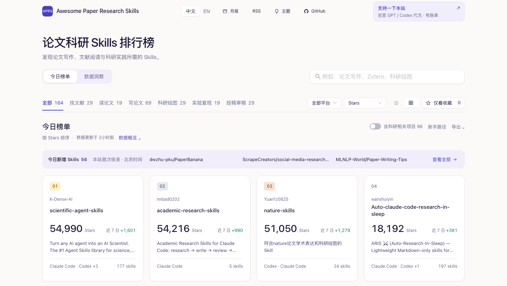

# Awesome Paper Research Skills

**发现适合你的论文科研 Skills。**

汇集 GitHub 上用于文献检索、论文阅读、学术写作、科研绘图和实验复现的 Agent Skills，支持按使用场景与适用平台筛选，持续追踪新收录项目和 Stars 增长。科研相关工具、工作流与资料单独标注。

### [打开论文科研 Skills 排行榜 →](https://riceai88.github.io/awesome-paper-research-skills/)

[今日新增](#今日新增-skills) · [Skills 榜单](#skills-榜单) · [科研相关项目](#科研相关项目) · [收录与更新](#收录与更新) · [推荐项目](CONTRIBUTING.md) · [English](#english)

*界面预览；图片中的数量仅代表截图时的数据，最新结果以网站为准。*

## 按科研任务找 Skills

| 你想做什么 | 从这里开始 |
|---|---|
| 查找论文、检索参考文献 | [找文献](https://riceai88.github.io/awesome-paper-research-skills/#task=find) |
| 阅读、总结或翻译论文 | [读论文](https://riceai88.github.io/awesome-paper-research-skills/#task=read) |
| 整理写作思路、修改表达、处理 LaTeX | [写论文](https://riceai88.github.io/awesome-paper-research-skills/#task=write) |
| 制作论文配图、图表和科研示意图 | [科研绘图](https://riceai88.github.io/awesome-paper-research-skills/#task=figures) |
| 复现实验、运行评估与基准测试 | [实验复现](https://riceai88.github.io/awesome-paper-research-skills/#task=reproduce) |
| 准备投稿、审稿与返修回复 | [投稿审稿](https://riceai88.github.io/awesome-paper-research-skills/#task=review) |

一个项目可以用于多个场景。网站默认只展示有 `SKILL.md` 文件证据的 Skills；需要科研工具或资料时，可打开“含科研相关项目”。

## 网站怎么用

- **发现新项目**：查看“今日新增”，也可按近 7 日增长、趋势或最近更新排序。
- **找到适合的平台**：搜索关键词，按 Claude Code、Codex、Cursor、MCP 等适用平台筛选；平台信息来自项目声明与规则识别，安装前以项目文档为准。
- **查看使用条件**：点击卡片打开详情，查看安装入口、适用任务、必要依赖与维护信息；已记录安装核对的项目提供核对记录。
- **收藏与对比**：收藏感兴趣的项目，加入对比后比较任务、安装方式、依赖和维护状态；收藏保存在当前浏览器。
- **观察趋势**：切换到“数据洞察”，查看增长、场景分布与规模比较；筛选条件与榜单联动。
- **分享与订阅**：复制当前筛选链接，或使用 [RSS](feed.xml)、[月报](reports/)、[JSON](data/rankings.json) 和 [CSV](data/rankings.csv)。

## 今日新增 Skills

新增 Skills **61** · 按本次更新时间所在的北京时间自然日统计 · “新增”指本站首次收录，不是仓库刚创建。

- **[dwzhu-pku/PaperBanana](https://github.com/dwzhu-pku/PaperBanana)** — PaperBanana: Automating Academic Illustration For AI Scientists
- **[alchaincyf/darwin-skill](https://github.com/alchaincyf/darwin-skill)** — 达尔文.skill —— 一个让你的Skill无限进化的系统：评估→改进→测试→保留或回滚 \| Autoresearch-inspired autonomous skill op…
- **[ScrapeCreators/social-media-research-skills](https://github.com/ScrapeCreators/social-media-research-skills)** — AI agent skills for social media research. Outlier posts, comment mining, competitor tear…
- **[MLNLP-World/Paper-Writing-Tips](https://github.com/MLNLP-World/Paper-Writing-Tips)** — MLNLP社区用来帮助大家避免论文投稿小错误的整理仓库。 Paper Writing Tips
- **[synthetic-sciences/openscience](https://github.com/synthetic-sciences/openscience)** — The open-source AI workbench for scientific research

[查看网站今日新增](https://riceai88.github.io/awesome-paper-research-skills/#today=skill) · 本节最多展示 5 个，完整列表见网站。初始导入的基线项目不计为今日新增。

## Skills 榜单

Skills **169** · 科研相关项目 **103** · 类型待核验 **1**

更新时间：**2026-10-28 16:55 UTC+8**。以下为 Skills 前 20 名，按 Stars 降序排列；同 Stars 时依次按趋势分和仓库名排序，筛选项目类型后重新编号。Stars 与增长反映关注度，不代表科研质量、安装兼容性或推荐保证。

| # | 仓库 | Stars | 近 7 日 | 适用平台 | 作者原文简介 |
|---:|---|---:|---:|---|---|
| 1 | [K-Dense-AI/scientific-agent-skills](https://github.com/K-Dense-AI/scientific-agent-skills) | 55,021 | +1,632 | Claude/Codex/Cursor | Turn any AI agent into an AI Scientist. The #1 Agent Skills library for science, used by… |
| 2 | [Imbad0202/academic-research-skills](https://github.com/Imbad0202/academic-research-skills) | 54,250 | +1,024 | Claude | Academic Research Skills for Claude Code: research → write → review → revise → finalize |
| 3 | [Yuan1z0825/nature-skills](https://github.com/Yuan1z0825/nature-skills) | 51,092 | +1,321 | Codex | 符合nature论文学术表达和科研绘图的Skill |
| 4 | [wanshuiyin/Auto-claude-code-research-in-sleep](https://github.com/wanshuiyin/Auto-claude-code-research-in-sleep) | 18,209 | +398 | Claude/Codex/MCP | ARIS ⚔️ (Auto-Research-In-Sleep) — Lightweight Markdown-only skills for autonomous ML res… |
| 5 | [Orchestra-Research/AI-Research-SKILLs](https://github.com/Orchestra-Research/AI-Research-SKILLs) | 14,025 | +254 | Claude/Codex/Gemini | Comprehensive open-source library of AI research and engineering skills for any AI model.… |
| 6 | [Imbad0202/academic-research-skills-codex](https://github.com/Imbad0202/academic-research-skills-codex) | 13,652 | +391 | Codex | Codex-native Academic Research Skills suite for human-in-the-loop academic research workf… |
| 7 | [HKUSTDial/Supervisor-Skills](https://github.com/HKUSTDial/Supervisor-Skills) | 10,858 | +588 | 通用 | 将博导十年科研经验炼化为可直接调用的 AI 技能。从 Idea 构思到论文投稿，你的 AI 科研副导师。 |
| 8 | [ChenLiu-1996/figures4papers](https://github.com/ChenLiu-1996/figures4papers) | 9,280 | +497 | 通用 | My Python scripts to make high-quality figures for publications in top AI conferences and… |
| 9 | [Master-cai/Research-Paper-Writing-Skills](https://github.com/Master-cai/Research-Paper-Writing-Skills) | 7,881 | +223 | Claude/Codex/Gemini | Skill package for ML/CV/NLP paper writing, curated and adapted from Prof. Peng Sida's ope… |
| 10 | [dwzhu-pku/PaperBanana](https://github.com/dwzhu-pku/PaperBanana) | 7,471 | +4 | 通用 | PaperBanana: Automating Academic Illustration For AI Scientists |
| 11 | [alchaincyf/darwin-skill](https://github.com/alchaincyf/darwin-skill) | 6,674 | — | Claude | 达尔文.skill —— 一个让你的Skill无限进化的系统：评估→改进→测试→保留或回滚 \| Autoresearch-inspired autonomous skill op… |
| 12 | [jihe520/MathModelAgent](https://github.com/jihe520/MathModelAgent) | 6,258 | +33 | 通用 | 🤖📐专为数学建模设计的 Agent & skills ,自动完成数学建模，生成一份完整的可以直接提交的论文。 An Agent Designed for Mathematical… |
| 13 | [WUBING2023/PaperSpine](https://github.com/WUBING2023/PaperSpine) | 6,099 | +1 | 通用 | PaperSpine5 — local-first, evidence-bound paper research, writing, figures, review and de… |
| 14 | [zLanqing/codex-claude-academic-skills](https://github.com/zLanqing/codex-claude-academic-skills) | 5,408 | +258 | Claude/Codex | 本仓库包含三个面向学术科研人员的Skills，覆盖从文献阅读、论文写作到科学计算的完整研究工作流。office-academic-skill 负责论文阅读报告与学术 PPT/Wo… |
| 15 | [ScrapeCreators/social-media-research-skills](https://github.com/ScrapeCreators/social-media-research-skills) | 4,964 | +6 | Claude/Codex/Cursor/Gemini | AI agent skills for social media research. Outlier posts, comment mining, competitor tear… |
| 16 | [brycewang-stanford/Auto-Empirical-Research-Skills](https://github.com/brycewang-stanford/Auto-Empirical-Research-Skills) | 4,799 | +95 | 通用 | 🔬 A curated collection of 23,000+ agent skills for empirical research across 8 social sci… |
| 17 | [MLNLP-World/Paper-Writing-Tips](https://github.com/MLNLP-World/Paper-Writing-Tips) | 4,693 | — | 通用 | MLNLP社区用来帮助大家避免论文投稿小错误的整理仓库。 Paper Writing Tips |
| 18 | [Adkid-Zephyr/anti-defensive-writing-Skill](https://github.com/Adkid-Zephyr/anti-defensive-writing-Skill) | 4,290 | +697 | 通用 | 极致轻量｜阻止论文的防御性写作 \| Anti-defensive writing for academic papers — 学术写作原则 Skill + prompt pack… |
| 19 | [synthetic-sciences/openscience](https://github.com/synthetic-sciences/openscience) | 4,275 | +3 | 通用 | The open-source AI workbench for scientific research |
| 20 | [jmiao24/Paper2Agent](https://github.com/jmiao24/Paper2Agent) | 3,895 | — | 通用 | Paper2Agent is a multi-agent AI system that automatically transforms research papers into… |

[浏览完整 Skills 榜单](https://riceai88.github.io/awesome-paper-research-skills/) · 简介保留仓库作者原文，仅截短展示；“—”表示近 7 日增量为 0，缺少历史记录时的计算方式见[排名方法](docs/methodology.md)。

## 科研相关项目

以下为科研工具、工作流和资料等相关项目的前 10 名，独立按 Stars 顺序展示，不混入上方 Skills 排名。

| # | 仓库 | Stars | 近 7 日 | 适用平台 | 作者原文简介 |
|---:|---|---:|---:|---|---|
| 1 | [binary-husky/gpt_academic](https://github.com/binary-husky/gpt_academic) | 71,566 | — | 通用 | 为GPT/GLM等LLM大语言模型提供实用化交互接口，特别优化论文阅读/润色/写作体验，模块化设计，支持自定义快捷按钮&函数插件，支持Python和C++等项目剖析&自译解功能，… |
| 2 | [mli/paper-reading](https://github.com/mli/paper-reading) | 34,032 | — | 通用 | 深度学习经典、新论文逐段精读 |
| 3 | [AccumulateMore/CV](https://github.com/AccumulateMore/CV) | 24,148 | — | 通用 | ✅（已完结）超级全面的 深度学习 笔记【土堆 Pytorch】【李沐 动手学深度学习】【吴恩达 深度学习】【大飞 大模型Agent】 |
| 4 | [amusi/CVPR2026-Papers-with-Code](https://github.com/amusi/CVPR2026-Papers-with-Code) | 22,929 | +1 | 通用 | CVPR 2026 论文和开源项目合集 |
| 5 | [kaixindelele/ChatPaper](https://github.com/kaixindelele/ChatPaper) | 19,974 | +2 | 通用 | Use ChatGPT to summarize the arXiv papers. 全流程加速科研，利用chatgpt进行论文全文总结+专业翻译+润色+审稿+审稿回复 |
| 6 | [extreme-assistant/CVPR2024-Paper-Code-Interpretation](https://github.com/extreme-assistant/CVPR2024-Paper-Code-Interpretation) | 12,454 | — | 通用 | cvpr2024/cvpr2023/cvpr2022/cvpr2021/cvpr2020/cvpr2019/cvpr2018/cvpr2017 论文/代码/解读/直播合集，极市团… |
| 7 | [hoochanlon/hamuleite](https://github.com/hoochanlon/hamuleite) | 9,949 | +28 | 通用 | 🌊深度整合全球顶尖学术、金融与教育资源：学术板块汇聚 JSTOR、Taylor & Francis、剑桥大学出版社等权威平台的论文，并接入 Z-Library 影子图书馆的海量电… |
| 8 | [LAMDA-NeSy/Research-Starter-Kit](https://github.com/LAMDA-NeSy/Research-Starter-Kit) | 9,092 | +12 | 通用 | 从0开始，掌握做科研、写论文的基本流程。 |
| 9 | [AhmadHassan-BTed/Turnitout-Humanizer](https://github.com/AhmadHassan-BTed/Turnitout-Humanizer) | 8,604 | +85 | 通用 | FREE FOREVER, NO LIMITS 100% Programmatic, Zero-AI Plagiarism Remover & Similarity Evader… |
| 10 | [src-d/awesome-machine-learning-on-source-code](https://github.com/src-d/awesome-machine-learning-on-source-code) | 6,662 | — | 通用 | Cool links & research papers related to Machine Learning applied to source code (MLonCode) |

[浏览科研相关项目](https://riceai88.github.io/awesome-paper-research-skills/#related=1)（打开后与 Skills 合并展示）。类型待核验项目不计入两张表，待文件证据确认后再归类；有 `SKILL.md` 也不等同于已通过安装测试。

## 收录与更新

**数据从哪里来？** 使用 GitHub API 获取仓库公开信息，通过热门搜索、最近更新搜索、Stars 区间搜索和维护者推荐发现候选；新候选读取 README 核验其自身科研用途，已有项目独立复查。搜索与核验有预算和覆盖限制，不保证收齐 GitHub 上所有科研 Skills。

**哪些项目会收录？** 当前 Stars 门槛为 **100**，排除 fork、归档和明确无关项目。Skills／科研工作流与科研相关工具／指南采用分轨准入；检测默认分支的 `SKILL.md` 文件后标注类型。暂时请求失败时保留此前合格项目的缓存并标记待核验，不因跌出搜索结果就直接移除。

**怎样排名？** 主榜按 Stars 排序，增长来自历史快照；趋势分仅作辅助，也可在网站切换排序。完整规则、字段含义和历史数据说明见[排名方法](docs/methodology.md)，采集过程见[采集报告](data/collection-report.json)与[变更记录](data/collection-events.json)。

**什么时候更新？** [Update rankings](https://github.com/RiceAI88/awesome-paper-research-skills/actions/workflows/update-rankings.yml) 计划每日 **北京时间 10:20（02:20 UTC）**运行。GitHub Actions 定时任务可能排队或延迟，计划时间不等于数据发布时间，也不保证每天都有新增。运行结果见 Actions；有仓库维护权限时，可在该工作流选择 **Run workflow** 手动触发。

README 会由采集脚本自动生成，静态介绍需修改 [`render_readme`](scripts/update_rankings.py)，再用已有数据重新生成；不要只改 README 后等待下一次采集覆盖。采集会同步维护榜单、首次收录记录、近 60 天历史快照和订阅资产。

## 推荐项目与参与维护

发现遗漏或分类错误，可[提交推荐 Issue](https://github.com/RiceAI88/awesome-paper-research-skills/issues/new?template=recommend-repo.yml)，附仓库链接、具体科研用途和 Skill／安装文档入口。也欢迎修正文档、核对安装信息、改进搜索和页面体验，详见[贡献指南](CONTRIBUTING.md)。

开发者从[前端开发文档](docs/frontend-development.md)开始；安装记录与精选维护分别见[安装核验](docs/installation-audit.md)和[精选维护说明](docs/editorial-maintenance.md)。

## English

**Awesome Paper Research Skills** helps you discover GitHub Agent Skills for literature search, paper reading, academic writing, scientific figures, experiment reproduction and peer review.

[Open the dashboard](https://riceai88.github.io/awesome-paper-research-skills/en/) to search by task and platform, inspect installation information, save favorites, compare repositories and explore growth charts. Descriptions stay in the repository author's original language.

The default ranking contains repositories with detected `SKILL.md` files. Research-related tools, workflows and guides are separately labelled and can be included with a toggle; unverified types are excluded from both previews. File detection does not certify quality or successful installation.

Candidates are discovered through popular, recently updated and star-banded searches, then reviewed against README evidence. The main ranking uses Stars; daily arrivals mean first inclusion on this site, measured by the Beijing calendar day. The scheduled daily refresh may be delayed and does not guarantee new entries every day. Search coverage is bounded.

[Methodology](docs/methodology.md) · [Contributing](CONTRIBUTING.md) · [JSON](data/rankings.json) · [CSV](data/rankings.csv) · [RSS](feed.xml)

## 来源与致谢

本项目基于 [kael-odin/awesome-academic-research-skills](https://github.com/kael-odin/awesome-academic-research-skills) 导入并进行后续改版，感谢原作者 [kael-odin](https://github.com/kael-odin) 的开源贡献。

本仓库由 RiceAI88 独立维护，后续将首页迁移至 React，并增加场景入口、项目类型区分、今日新增、项目对比、数据洞察与采集核验机制。保留原项目的 MIT 许可证和版权声明；不代表原作者或与原作者存在隶属关系。早期导入的历史快照不代表本站当时已运行。

## License

[MIT](LICENSE)
